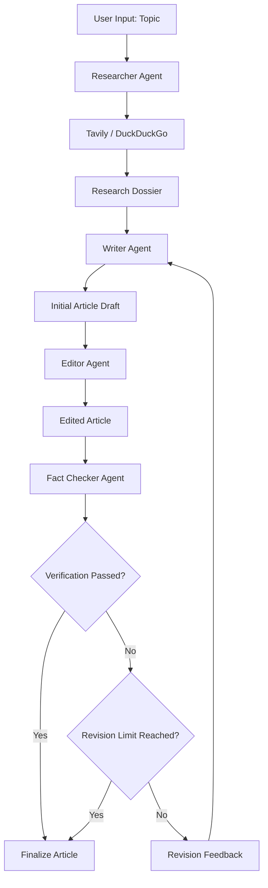

# 🤖 AI Multi-Agent Content Creation Studio

A multi-agent AI content generation and fact-checking application built using **Python, LangGraph, LangChain, Groq, Google Gemini, Tavily, DuckDuckGo, and Streamlit**.

The application coordinates four specialized AI agents to automate web research, article generation, content editing, and factual verification.

It uses **LangGraph StateGraph orchestration, shared state management, conditional routing, and a feedback-driven revision mechanism** to improve generated content.

---

## 🌟 Key Features

- **Multi-Agent Architecture:** Four specialized agents for research, writing, editing, and fact-checking.
- **LangGraph Orchestration:** Coordinates agent execution through a graph-based workflow.
- **Shared State Management:** Maintains research results, article drafts, verification reports, and execution information across agents.
- **Automated Fact-Checking:** Evaluates article claims against retrieved research evidence.
- **Conditional Workflow Routing:** Determines whether an article should be finalized or sent for revision.
- **Feedback-Driven Revision:** Returns corrective feedback to the Writer when unsupported claims are identified.
- **Multiple LLM Providers:** Supports configurable Groq and Google Gemini models.
- **Web Research Integration:** Uses Tavily and DuckDuckGo for information retrieval.
- **Interactive Streamlit Dashboard:** Monitors agent execution and displays research, article drafts, and fact-checking results.
- **Article Export:** Downloads generated articles in Markdown format.

---

## 🏗️ System Architecture

The application uses LangGraph to coordinate four specialized agents through a shared state.



### Agent Responsibilities

| Agent | Responsibility |
|---|---|
| Researcher | Generates search queries, retrieves relevant information, and prepares a research dossier. |
| Writer | Generates structured articles using the research dossier and user preferences. |
| Editor | Improves grammar, readability, structure, and writing quality. |
| Fact Checker | Evaluates factual claims against research evidence and generates corrective feedback. |

---

## 🔄 Workflow Execution

1. **User Input:** The user provides an article topic, writing tone, target audience, and maximum revision limit.
2. **Research:** The Researcher retrieves relevant information using configured web search tools.
3. **Content Generation:** The Writer generates an article using the research dossier.
4. **Editing:** The Editor improves the initial article draft.
5. **Fact Verification:** The Fact Checker evaluates claims against the available research evidence.
6. **Conditional Routing:** LangGraph evaluates the verification result and determines the next execution step.
7. **Revision:** If verification fails and revision attempts remain, feedback is sent to the Writer for targeted corrections.
8. **Finalization:** The application displays the resulting article along with its audit report and execution information.

The revision process is controlled through a configurable maximum revision limit.

**Note:** The fact-checking score is an LLM-generated evaluation signal and does not guarantee factual correctness. Human review is recommended.

---

## 🧠 Core Technical Concepts

- LangGraph StateGraph and workflow orchestration.
- Shared state management using AgentState.
- Node and edge-based execution.
- Conditional routing using conditional edges.
- Cyclic workflow execution and feedback loops.
- LLM integration using LangChain.
- External API integration.
- Structured data handling.
- Configuration and environment management.

---

## 🛠️ Technology Stack

| Technology | Purpose |
|---|---|
| Python | Core application development |
| LangGraph | Multi-agent workflow orchestration |
| LangChain | LLM integration and model interfaces |
| Groq | Primary configurable LLM provider |
| Google Gemini | Alternative LLM provider |
| Tavily | Web search and information retrieval |
| DuckDuckGo (ddgs) | Alternative web search |
| Streamlit | Interactive frontend |
| Pydantic | Data validation |
| python-dotenv | Environment variable management |

---

## 📁 Project Structure

```text
robust/
│
├── .env.example
├── .gitignore
├── requirements.txt
├── README.md
├── app.py
│
└── src/
    ├── config.py
    ├── state.py
    ├── llm.py
    ├── graph.py
    │
    ├── tools/
    │   └── search.py
    │
    └── agents/
        ├── researcher.py
        ├── writer.py
        ├── editor.py
        └── fact_checker.py
```

---

## ⚙️ Installation and Setup

### 1. Clone the Repository

```bash
git clone YOUR_GITHUB_REPOSITORY_URL
cd robust
```

### 2. Create a Virtual Environment

**Windows:**

```bash
python -m venv venv
venv\Scripts\activate
```

**Linux / macOS:**

```bash
python -m venv venv
source venv/bin/activate
```

### 3. Install Dependencies

```bash
pip install -r requirements.txt
```

### 4. Configure Environment Variables

Create a `.env` file in the project root.

```env
LLM_PROVIDER=groq

GROQ_API_KEY=your_groq_api_key
GEMINI_API_KEY=your_gemini_api_key

TAVILY_API_KEY=your_tavily_api_key
```

Configure the API credentials required by your selected providers.

Keep your `.env` file private and never commit API keys to GitHub.

---

## 🚀 Running the Application

Launch the Streamlit application:

```bash
streamlit run app.py
```

Open the application in your browser:

```text
http://localhost:8501
```

### Dashboard Capabilities

The interactive dashboard provides:

- Topic input and article generation.
- LLM provider and model selection.
- Writing tone and target audience configuration.
- Maximum revision cycle selection.
- Agent execution progress and logs.
- Research dossier and retrieved sources.
- Fact-checking reports and claim verification.
- Writer versus Editor article comparison.
- Final article preview and Markdown download.

---

## 📊 Application Output

The application provides five major result sections:

1. **Published Article:** Displays the generated article.
2. **Fact-Check Audit:** Displays verification results, confidence levels, and corrective feedback.
3. **Research Dossier:** Displays synthesized research and retrieved sources.
4. **Writer vs. Editor:** Compares the initial article with the edited version.
5. **Execution Trace:** Displays chronological agent execution logs.

---

## ⚠️ Limitations

- Search quality depends on the relevance and reliability of retrieved sources.
- LLM-generated content can contain unsupported or inaccurate information.
- Fact-checking results require human review.
- External API rate limits and availability can affect execution.
- Repeated LLM calls can increase latency and API consumption.
- Reaching the revision limit does not necessarily mean that the article passed verification.

---

## 🔮 Future Improvements

- Integrate LangSmith for LLM tracing, debugging, and observability.
- Add FastAPI to expose the workflow through REST APIs.
- Implement persistent workflow history using a database.
- Improve claim-level evidence verification.
- Introduce retry mechanisms and exponential backoff.
- Add Docker-based deployment.
- Implement automated evaluation datasets.
- Add authentication and API security.

---

## 🎯 Project Objective

This project demonstrates the practical application of Generative AI and multi-agent workflow orchestration through specialized LLM-driven components.

It explores shared state management, conditional execution, feedback-driven revision, external tool integration, and the development of interactive AI applications.